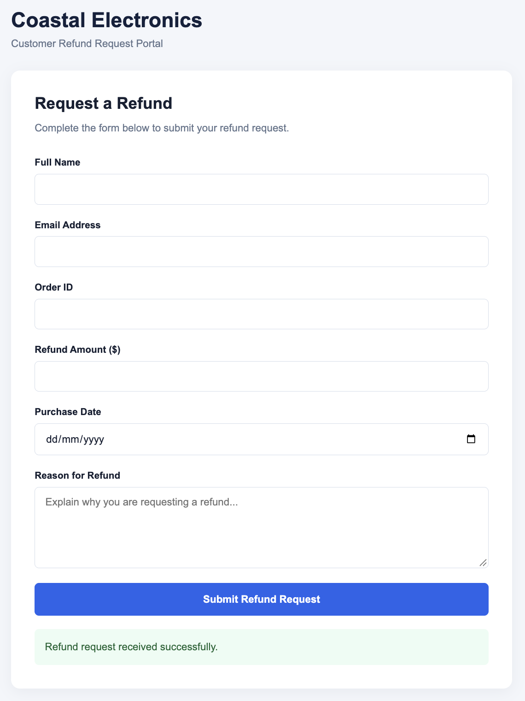
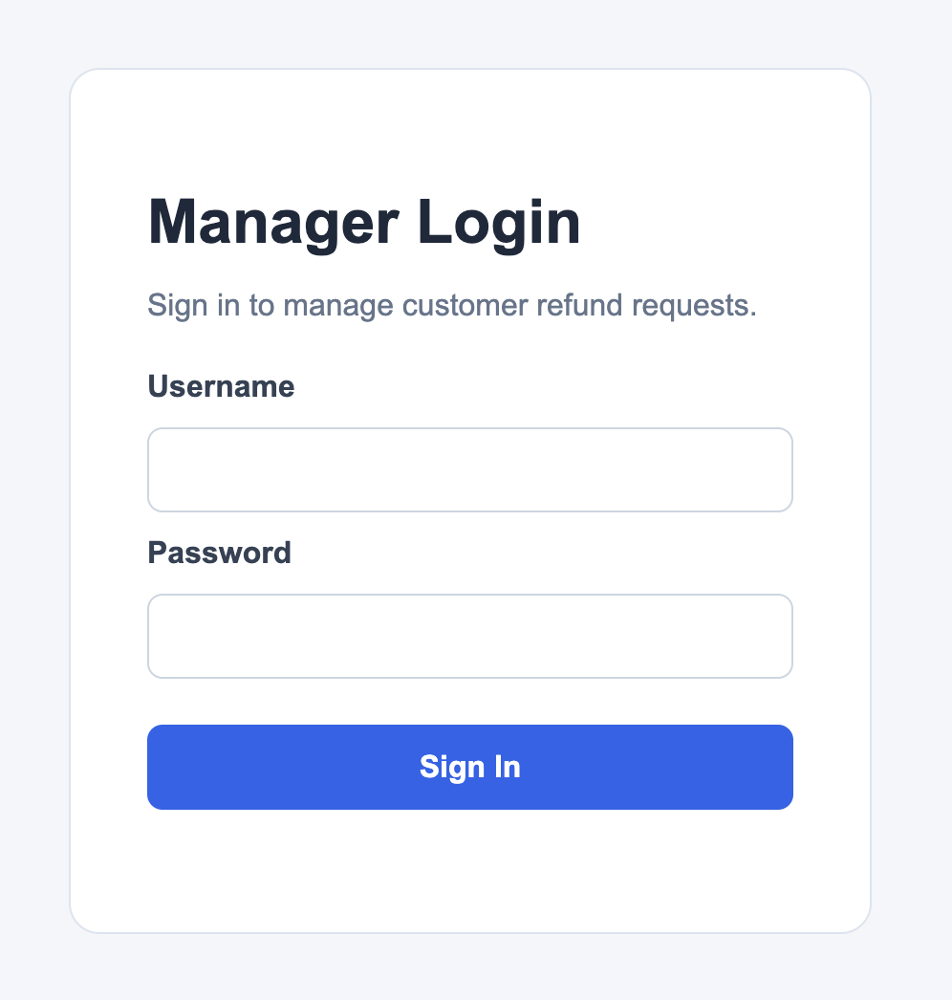
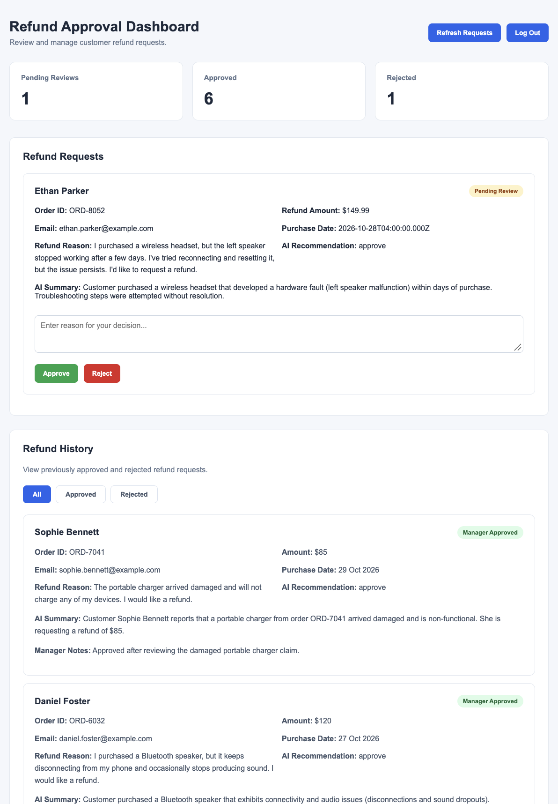
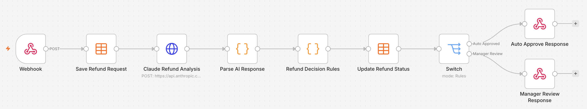
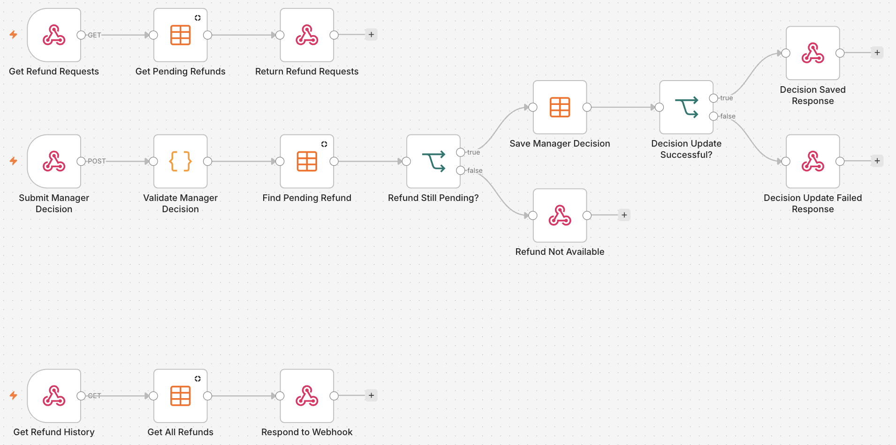

# AI-Powered Refund Automation | Human-in-the-Loop

An end-to-end refund management prototype that combines AI analysis, rule-based automation, and human approval to process customer refund requests.

Built using n8n, Claude AI, Node.js, Express, JavaScript, HTML, and CSS.

The system automatically evaluates refund requests, approves eligible low-risk cases, and routes other requests to a manager dashboard for human review.

This project demonstrates how businesses can use AI to support operational decisions while retaining human control over higher-risk actions.


## Business Applications

This project demonstrates the ability to build AI-assisted business workflows that automate routine decisions while requiring human approval for higher-risk or exceptional cases.

The same architecture can be adapted to a range of commercial applications:

- **Financial Approval Workflows:** Automatically assess expense claims, invoices, and purchase requests, escalating transactions above predefined thresholds to authorised managers.
- **Customer Service Automation:** Analyse customer complaints, returns, and refund requests, automatically resolving straightforward cases and routing exceptions to employees.
- **Document Review and Approvals:** Use AI to extract and assess information from submitted documents, then present recommendations to staff for verification and approval.
- **Operations and Compliance:** Flag unusual transactions, incomplete records, or policy exceptions for human review before further processing.
- **CRM and Internal Workflow Automation:** Route requests between employees, record decisions, update business systems, and maintain approval histories.

### Business Value

These solutions can help organisations:

- Reduce time spent manually reviewing routine requests.
- Improve consistency through predefined decision rules.
- Maintain human oversight of important decisions.
- Create traceable records of approvals, rejections, and employee notes.
- Connect AI analysis with existing business software and internal processes.
- Scale administrative workflows without proportionally increasing manual workloads.

**Core Capability Demonstrated:** Designing and implementing human-in-the-loop automation systems that combine AI analysis, business rules, authenticated APIs, management dashboards, and structured decision tracking.

## Screenshots

### Customer Refund Portal



### Manager Login



### Manager Approval Dashboard



### Refund Processing Workflow



### Manager Dashboard API Workflow



## Features

- Customer-facing refund request form.
- AI-powered analysis of customer refund reasons using Claude.
- Automatic approval of eligible low-risk refund requests.
- Rule-based decision-making independent of AI recommendations.
- Human approval and rejection of requests requiring review.
- Manager authentication and protected API endpoints.
- Manager notes recorded alongside approval decisions.
- Centralised refund tracking using n8n Data Tables.
- Refund history with approved and rejected filters.
- Dashboard statistics for pending, approved, and rejected requests.
- Duplicate decision prevention through pending-status checks.
- Error handling for unavailable or previously processed requests.
- Separation of customer-facing and manager-facing interfaces.

## Technologies Used

| Technology | Purpose |
|------------|---------|
| n8n | Workflow automation, webhooks, and process orchestration |
| Claude AI | Refund analysis, categorisation, risk assessment, and recommendations |
| Anthropic API | Communication with Claude |
| Node.js | Local backend runtime |
| Express.js | Manager authentication and API endpoints |
| JavaScript | Backend logic, frontend functionality, and workflow decision rules |
| HTML | Customer portal and manager dashboard structure |
| CSS | Interface styling |
| n8n Data Tables | Storage and retrieval of refund requests |
| REST APIs | Communication between the frontend, backend, and automation workflows |

## How the System Works

### 1. Customer Submits a Refund Request

The customer opens the refund portal and enters:

- Full name
- Email address
- Order ID
- Refund amount
- Purchase date
- Reason for requesting a refund

The frontend sends the request to an n8n webhook using an HTTP POST request.

### 2. Refund Request Is Stored

n8n receives the submission and creates a record in the `refund_requests` Data Table.

The request initially receives the status `pending_analysis`.

This allows the system to maintain a record of the request while AI analysis takes place.

### 3. Claude AI Analyses the Request

The workflow sends the refund information to Claude through the Anthropic API.

Claude returns structured JSON containing:

- Refund category
- Risk level
- Summary of the customer's issue
- Recommended action
- Reasoning behind the recommendation

Example AI response:

```json
{
  "category": "faulty_product",
  "risk_level": "low",
  "summary": "Customer reports receiving a defective electronic product.",
  "recommendation": "approve",
  "reasoning": "The request describes a product fault and presents low apparent risk."
}
```

Claude provides a recommendation but does not independently authorise the refund.

### 4. Deterministic Refund Decision Rules

A JavaScript Code node evaluates the request against predefined business rules.

A refund is automatically approved only when all of the following conditions are satisfied:

- Refund amount is $50 or less.
- Purchase occurred within the last 30 days.
- Refund category is `faulty_product` or `wrong_item`.
- AI risk assessment is `low`.
- AI recommendation is `approve`.
- Required customer information is present and valid.

If every condition is satisfied, the request receives the status `auto_approved`.

If any condition fails, the request receives the status `pending_review`.

This separates AI analysis from the final automated business decision.

### 5. Human Review

Requests requiring manager approval appear in a separate dashboard.

The dashboard displays:

- Customer details
- Order information
- Requested refund amount
- Purchase date
- Customer's refund explanation
- AI-generated summary
- AI recommendation

A manager can review the information and either approve or reject the request.

The manager must enter a reason for the decision.

### 6. Manager Decision Is Validated and Saved

The dashboard sends the manager's decision to a protected Express backend.

The backend forwards the request to an authenticated n8n webhook.

The n8n workflow:

1. Validates the refund request ID.
2. Validates the approval or rejection decision.
3. Requires manager notes containing at least five characters.
4. Checks that the refund request is still pending.
5. Updates the refund record with the manager's decision.
6. Verifies that the updated status matches the requested decision.
7. Returns a success or failure response.

Requests that have already been processed cannot normally be approved or rejected again.

If the request is no longer pending, the API returns HTTP 409 Conflict.

The dashboard refreshes to reflect the updated status.

### 7. Refund History and Dashboard Statistics

Completed requests remain available in the manager dashboard.

Managers can filter the refund history by:

- All completed requests
- Approved requests
- Rejected requests

The dashboard also displays totals for pending reviews, approvals, and rejections.

Both automatically approved and manager-approved requests contribute to the approved total.

## System Architecture

The system uses two separate n8n workflows.

### Workflow 1: Refund Processing

Customer Refund Portal

1. Receive refund request through webhook.
2. Save request to Data Table.
3. Send refund details to Claude AI.
4. Parse AI-generated JSON.
5. Apply deterministic business rules.
6. Update refund status.
7. Route to automatic approval or manager review.
8. Return a response to the customer.

### Workflow 2: Manager Dashboard API

The second workflow contains three API processes.

**Retrieve Pending Refunds**

1. Receive authenticated GET request.
2. Retrieve requests with `pending_review` status.
3. Return pending requests as JSON.

**Submit Manager Decision**

1. Receive authenticated POST request.
2. Validate manager decision and notes.
3. Find the pending refund request.
4. Update the request.
5. Verify the saved decision.
6. Return the appropriate HTTP response.

**Retrieve Refund History**

1. Receive authenticated GET request.
2. Retrieve stored refund requests.
3. Return the records as JSON.

The Express backend sits between the manager dashboard and n8n, handling manager authentication and forwarding authenticated API requests.

## Project Structure

```text
Project 4 - Human in the Loop Automation/
|
|-- website/
|   |-- index.html
|   |-- style.css
|   |-- script.js
|
|-- manager-dashboard/
|   |-- index.html
|   |-- style.css
|   |-- script.js
|
|-- manager-backend/
|   |-- server.js
|   |-- package.json
|   |-- package-lock.json
|
|-- workflows/
|   |-- refund-processing-workflow.json
|   |-- manager-dashboard-api-workflow.json
|
|-- screenshots/
|   |-- customer-refund-form.png
|   |-- manager-login.png
|   |-- manager-dashboard.png
|   |-- refund-processing-workflow.png
|   |-- manager-dashboard-api-workflow.png
|
|-- workflow-design.md
|-- .gitignore
|-- README.md
```

Environment files, dependencies, and authentication secrets are excluded from version control.

## Local Setup

This project was developed and tested locally.

### Prerequisites

- Node.js and npm
- A running n8n instance
- An Anthropic API key
- Access to n8n Data Tables

### 1. Clone the Repository

```bash
git clone YOUR_REPOSITORY_URL
cd "Project 4 - Human in the Loop Automation"
```

### 2. Import the n8n Workflows

Import both JSON files from the `workflows` directory into n8n.

The exported workflows are portfolio templates and require configuration before use.

You will need to:

- Configure an Anthropic API authentication credential.
- Configure a manager API header authentication credential.
- Create a Data Table named `refund_requests`.
- Reconnect the Data Table nodes to the new table.
- Verify the webhook paths and workflow settings.
- Publish or activate the workflows as required by your n8n version.

The `refund_requests` Data Table uses these fields:

| Field | Type |
|-------|------|
| customer_name | String |
| customer_email | String |
| order_id | String |
| refund_amount | Number |
| purchase_date | Date/Time |
| refund_reason | String |
| status | String |
| ai_summary | String |
| ai_recommendation | String |
| manager_decision | String |
| manager_notes | String |

n8n also maintains its built-in record ID and timestamps.

### 3. Configure the Manager Backend

Navigate to the backend directory:

```bash
cd manager-backend
npm install
```

Create a `.env` file inside `manager-backend`:

```env
PORT=3001
MANAGER_API_KEY=YOUR_MANAGER_API_KEY
MANAGER_PASSWORD=YOUR_MANAGER_PASSWORD
N8N_DECISION_URL=http://localhost:5678/webhook/refund-decision
N8N_REFUNDS_URL=http://localhost:5678/webhook/refund_requests
N8N_HISTORY_URL=http://localhost:5678/webhook/refund_history
```

The manager API key must match the header authentication credential configured in n8n.

Do not commit the `.env` file to GitHub.

### 4. Start the Backend

From the `manager-backend` directory:

```bash
node server.js
```

Open the manager dashboard at:

```text
http://localhost:3001
```

Log in using:

- Username: `manager`
- Password: The value configured in `MANAGER_PASSWORD`

### 5. Open the Customer Refund Portal

Open `website/index.html` in a browser or serve the website through a local development server.

Ensure the webhook URL in `website/script.js` points to the active refund-processing webhook.

For the default local n8n configuration:

```text
http://localhost:5678/webhook/refund-request
```

Submit a test refund request and verify that it is recorded in n8n.

## Testing

The prototype was tested using fictional customer refund requests.

### Test Scenarios

| Scenario | Expected Result |
|----------|-----------------|
| Eligible low-value refund | Automatically approved |
| Refund exceeding $50 | Sent for manager review |
| Manager approves pending refund | Status updated to approved |
| Manager rejects pending refund | Status updated to rejected |
| Manager provides insufficient notes | Decision rejected by validation |
| Request already processed | HTTP 409 Conflict |
| Missing manager API authentication | Access denied |
| Manager login with valid credentials | Dashboard access granted |
| Refund history retrieved | Completed requests displayed |
| Refund history filter selected | Matching completed requests displayed |

Additional testing verified that manager decisions were stored alongside manager notes and that dashboard statistics updated after processing.

## Security and Human Oversight

The prototype incorporates several controls:

- Anthropic API credentials are managed through n8n credentials.
- Manager API requests require header authentication.
- The Express backend validates manager login credentials.
- Manager decision requests are validated before database updates.
- Only pending refund requests are eligible for manager decisions.
- The workflow checks the returned updated status before reporting success.
- Sensitive environment variables are excluded from Git.
- AI recommendations do not override the deterministic approval rules.
- Managers retain final control over requests requiring human review.

These controls demonstrate the principles of human-in-the-loop automation.

They do not constitute a complete production security implementation.

## Limitations and Future Improvements

This is a local portfolio prototype, not a production-ready refund processing service.

Current limitations include:

- No integration with a real payment processor.
- Automatic approval updates an internal record but does not issue a payment refund.
- No verification against a real order management system.
- No production deployment or HTTPS configuration.
- Basic manager authentication rather than a full session-based authentication system.
- No formal audit log or role-based access control.
- No guaranteed atomic protection against simultaneous manager decisions.
- Limited automated testing and operational monitoring.
- AI analysis depends on the availability of the Anthropic API.

Potential future improvements include:

- Integration with Shopify, Stripe, or another order/payment platform.
- Order verification before processing refund requests.
- Role-based authentication and secure session management.
- Database-backed audit trails.
- Transaction-safe decision updates.
- Automated email notifications to customers.
- Retry mechanisms and recovery workflows for API failures.
- Monitoring, logging, and alerting.
- Automated integration and end-to-end tests.
- Deployment using production-grade infrastructure.

## What I Learned

This project focused on implementing human-in-the-loop automation rather than relying entirely on AI-generated decisions.

Key learning outcomes included:

- Designing workflows that combine AI recommendations with deterministic business rules.
- Separating automated decisions from decisions requiring human approval.
- Building an authenticated manager-facing API.
- Connecting a JavaScript dashboard to a Node.js backend and n8n workflows.
- Implementing approval and rejection processes with validation.
- Managing request states throughout a multi-stage workflow.
- Handling previously processed requests and conflicting decisions.
- Building a searchable and filterable record of completed decisions.
- Designing automation systems that preserve human oversight.